# Northrop Grumman SCRM

The inspected client is `ng_subtier_demo`. Its hierarchical view combines a live Sisense model, React query/transformation logic, and an Ogma canvas. The configuration names the root supplier “Northrop Grumman.” This is evidence of a local demo configuration, not proof of a particular production deployment.

## Data used

`NG_SUBTIER_DEMO` is declared as a live data source. Its generated model exposes `BOM_RISK_TIERS`, ten `BOM_TIER_n` dimensions, and `BOM_TIERS_SPINE`. The [schema](schema.json) inventories the available attributes; the [role dictionary](field-roles.md) lists the 60 configured roles.

| Purpose | Configured mapping | Consumer |
| --- | --- | --- |
| Supplier names, tiers 1–10 | `BOM_TIER_n.ENTITY_NAME` | Supplier hierarchy prefix queries |
| Part keys/names, levels 0–9 | `BOM_TIER_n.BOM_TEXT`, where n = level + 1 | Part hierarchy query and graph construction |
| BOM search IDs | `BOM_TIERS_SPINE.TIERn_BOMID` | BOM ID search field list |
| BOM search labels | `BOM_TIERS_SPINE.TIERn_BOM_TEXT` | Part/BOM text search and some fallback label lookups |
| `finalRisk` input | `BOM_RISK_TIERS.TIERn_CONFIDENCE` | Part metric query, numeric aggregation, node data |
| Capacity | `BOM_TIER_n.CAPACITY` | Included in configured part metric fields; not a registered rendered risk metric |

Source: [configuration snapshot](config.snapshot.json), `/dataModels/hierarchical/fieldRoles`; [query evidence](evidence/config-and-queries.md); [metric evidence](evidence/metrics.md). Schema availability includes additional supplier counts, sourcing flags, evidence, and risk-related attributes; it does not mean all are displayed.

## How it becomes the visualization

```mermaid
flowchart LR
  A[NG client selection] --> B[Config and model registry]
  B --> C[Generated semantic attributes]
  C --> D[Compose SDK query hooks]
  D --> E[React row and metric mapping]
  E --> F[Ogma supplier or part hierarchy]
  F --> G[Node selection and expansion]
  G --> H[Tier dashboard lookup]
  H --> I[Compose SDK Dashboard and equality filter]
```

1. Set `REACT_APP_SUPPLY_CHAIN_CLIENT=ng_subtier_demo`. The inspected resolver otherwise defaults to Rolls Royce; an unknown client also falls back there. [Selection evidence](evidence/client-selection.md).
2. The registry resolves `src/ng-subtier_demo.ts`. The NG feature flags expose only `hierarchical`. [Registry](evidence/registry.md), [routing](evidence/feature-routing.md).
3. The React root wraps the app in `SisenseContextProvider`, with SSO and query caching enabled. [Provider](evidence/react-provider.md).
4. Supplier mode uses prefix queries from depth one to ten; each query projects the names through that depth and requests at most 100,000 rows. Prefix means a tier-column prefix, not a name-search prefix. [Queries](evidence/config-and-queries.md), original lines 2269–2408.
5. Part hierarchy, part metrics, part labels, and part/supplier associations use separate queries. The part association combines ten part columns followed by ten supplier columns and pairs them by index. Part queries can remain active in the background; NG does not enable the selection-before-load gate. [Queries](evidence/config-and-queries.md), original lines 2116–2140 and 3486–3584.
6. Graph construction reads positional `cell.data`. Supplier identities normally use tier and name, with a synthetic `T0:Northrop Grumman` root. Part child IDs include their parent path. Parent→child edges describe this hierarchy; do not impose the separate network view’s supplier→customer orientation. [Builder](evidence/hierarchy-builder.md).
7. A node click expands when configured, sets the analytics target from node `tier` and `name`, and supports the popover. [Analytics](evidence/analytics.md), original lines 6665–6700.

## Metric semantics that matter

`finalRisk` is populated from `TIERn_CONFIDENCE` in this config. Numeric values are averaged by tier/name in `buildMetricsByTier`; the generic part graph subsequently propagates the maximum of own and descendant metric values upward. Thus a displayed value can differ from a single underlying row. Confirm confidence scale and direction with the model owner before interpreting this as business risk. [Metrics](evidence/metrics.md); [builder](evidence/hierarchy-builder.md), original lines 1841–1865.

The risk menu registers `finalRisk`, `rcrRisk`, `financialHealth`, and `esgRisk`, but NG maps only `finalRisk` for parts and no supplier risk roles. Missing mappings are not evidence of low risk. Capacity appears in the part role maps and therefore projected fields, but `capacity` is absent from `risk.metrics`; the generic metric loop does not turn that mapping alone into a risk overlay. Threshold control is 0–1 in steps of 0.05, with 0.5 defaults. Watchlist and disruption categories are disabled. [Configuration](config.snapshot.json), `/risk` and `/hierarchicalViz/riskFieldRoles`.

## Analytics behavior and gaps

The configuration provides dashboard IDs at keys `1`, `2`, and `3`, and no default. Dashboard selection uses the clicked node’s numeric tier directly. Part tiers are zero-based, so part level 0 has no dashboard, levels 1–3 have configured IDs, and levels 4–9 have none. Do not silently shift the keys by one. This is a static routing result; dashboard contents and accessibility were not queried.

Part filters use `BOM_TIER_(level+1).BOM_TEXT`, with equality against the clicked node’s displayed name. The shared label-lookup logic can replace display names, so label/key consistency deserves verification against real rows. Supplier filter mappings are absent: a supplier may select a tier dashboard without adding a supplier-specific filter. A valid target filter replaces the translated dashboard’s `filters` array; it does not merge that array. Treat application filtering separately from server-side access controls. [Analytics evidence](evidence/analytics.md), [label evidence](evidence/part-labels.md), [config](config.snapshot.json).

## What the source cannot establish

The generated model records attribute expressions and types, not physical warehouse lineage, join definitions, refresh freshness, confidence methodology, actual row counts, or production permissions. This capture did not query the live instance. Obtain a model export and business definitions to answer those questions. Do not assume the generic Snowflake network procedure elsewhere in SCRM builds NG’s BOM model.

Continue with [worked questions](questions.md), [provenance](provenance.json), and the [evaluation prompts](../../evals/customer-questions.md).
